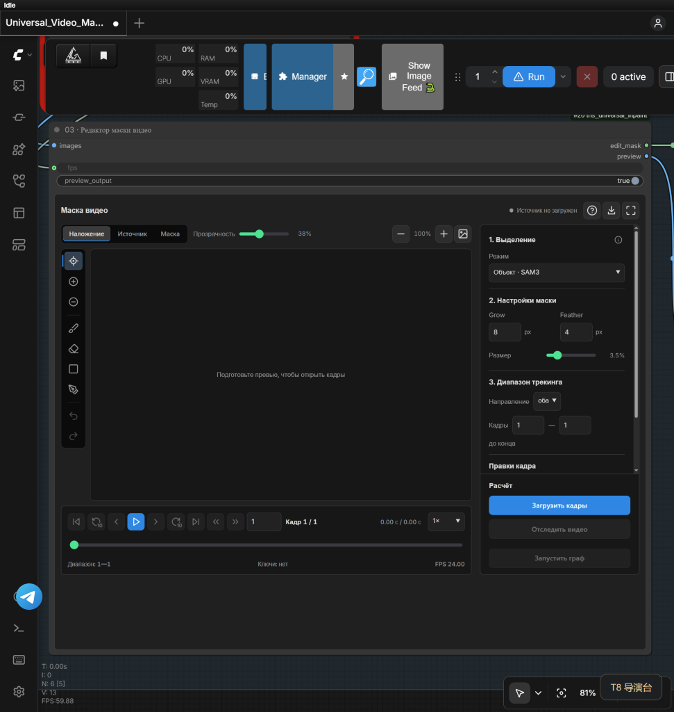
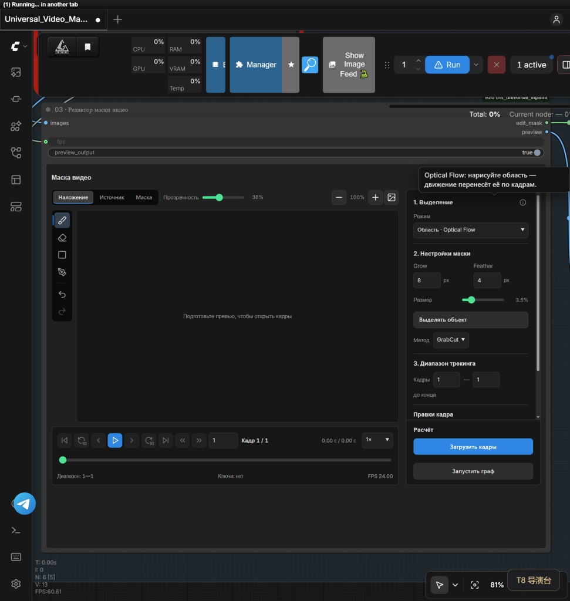
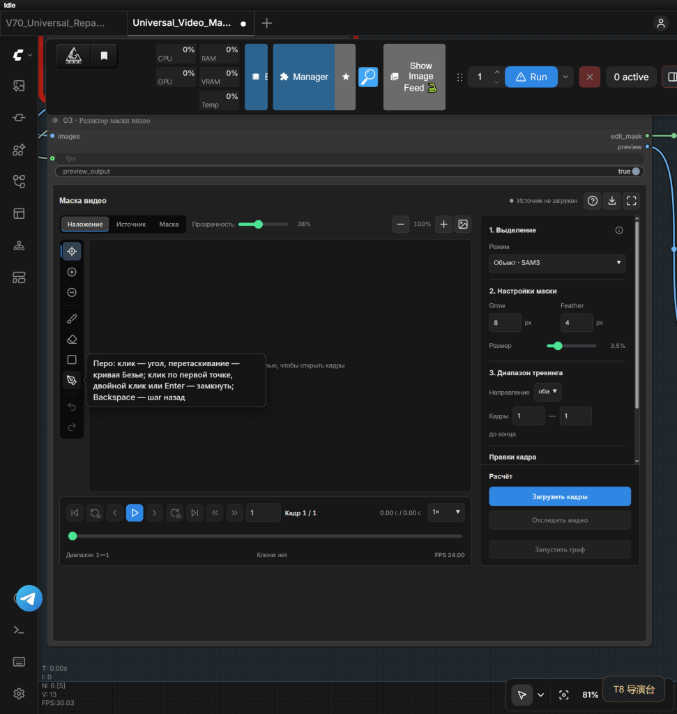
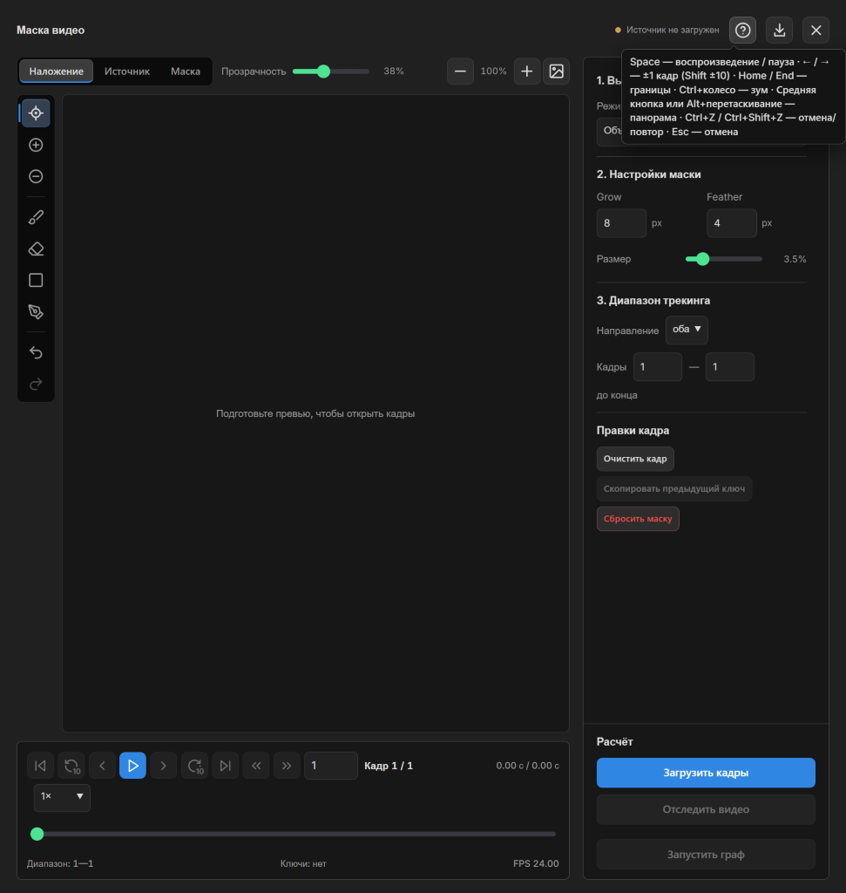
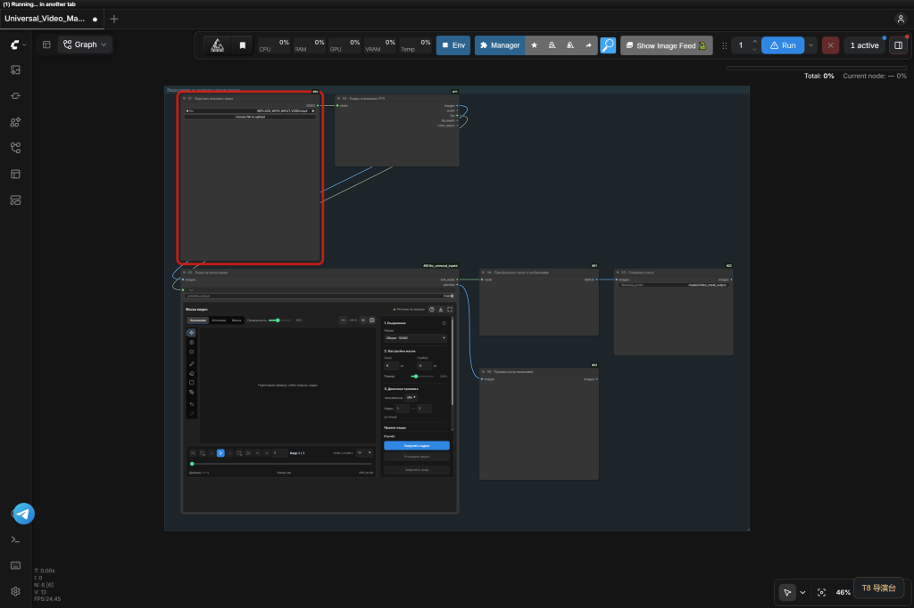

# ComfyUI Video Mask Editor

[English](README_EN.md) · [Пошаговое руководство со скриншотами](docs/USER_GUIDE_RU.md) · [Справочник входов и выходов](docs/NODES_RU.md) · [Установка и SAM3](docs/INSTALL_RU.md)

Интерактивная нода выделения объектов и трекинга видеомаски для ComfyUI — **`THSUniversalMaskEditor`** (*Редактор маски видео*). Позволяет выделять и отслеживать до 8 независимых объектов на видео, дорисовывать маски вручную кистью, прямоугольником и пером с кривыми Безье, тонко настраивать край и экспортировать готовую последовательность `MASK` + `IMAGE` в любой граф ComfyUI.

> Весь репозиторий посвящён только этой ноде и готовому минимальному графу [`workflows/Universal_Video_Mask_Editor.json`](workflows/Universal_Video_Mask_Editor.json).



## Содержание

- [Основные возможности ноды](#основные-возможности-ноды)
- [Режимы выделения и трекинга](#режимы-выделения-и-трекинга)
- [Инструменты левой панели и Перо Безье](#инструменты-левой-панели-и-перо-безье)
- [Просмотр, навигация и полноэкранный редактор](#просмотр-навигация-и-полноэкранный-редактор)
- [Входы, выходы и готовый граф ComfyUI](#входы-выходы-и-готовый-граф-comfyui)
- [Горячие клавиши и управление](#горячие-клавиши-и-управление)
- [Установка](#установка)
- [Локальные проверки](#локальные-проверки)

## Основные возможности ноды

- **Четыре независимых режима работы**: нейросетевой трекинг объектов **SAM3**, CPU-перенос областей по движению **Optical Flow**, **Ручные ключи** и **Неподвижная маска**.
- **До 8 независимых объектов SAM3** на одном клипе с двухэтапной проверкой: мгновенный предпросмотр опорного кадра по клику/рамке и отдельный запуск трекинга по выбранному направлению и диапазону кадров.
- **Профессиональный векторный инструмент «Перо»** с угловыми вершинами и симметричными кривыми Безье, живой направляющей, кольцом привязки замыкания на первой точке и откатом узлов по `Backspace`.
- **Чистый интерфейс без «скачков» вёрстки**: все подсказки появляются **только при наведении курсора или клавиатурном фокусе** через всплывающий Top-Layer тултип (`popover="hint"` с задержкой `650 мс`); постоянные баннеры убраны из потока, чтобы панели и холст никогда не дёргались при переключении инструментов, вкладок и режимов.
- **Сквозной полноэкранный режим `<dialog>`** с общим живым состоянием холста, таймлайна, истории `Ctrl+Z / Ctrl+Y` и настроек края.
- **Безопасный предпросмотр без запуска всего графа**: кнопки **«Загрузить кадры»**, **«Рассчитать кадр»** и **«Отследить видео»** рассчитывают только маску через `ExecutionBlocker`, не запуская последующие ноды графа раньше времени.
- **Защита от несовпадения источника**: при замене входного видео нода блокирует ошибочную маску, показывает источник и предлагает **«Начать маску для нового клипа»** или **«Вернуть прежнюю маску»**.

## Режимы выделения и трекинга

Режимы разделены строго и никогда не подменяют друг друга скрыто:

| Режим | ID | Где работает | Как устроен расчёт |
| --- | --- | --- | --- |
| **Объект · SAM3** | `sam3` | GPU (`facebook/sam3`, опц.) | Двухэтапный пайплайн: клик/точки/рамка на опорном кадре → **«Рассчитать кадр»** → уточнение и трекинг кнопкой **«Отследить видео»** (`вперёд`, `назад` или `оба`). Поддерживает до 8 отдельных объектов на клип. |
| **Область · Optical Flow** | `optical_flow` | CPU (OpenCV) | Перенос нарисованных масок по оптическому потоку между кадрами. Поддерживает автовыделение рамкой (`GrabCut` на CPU или `SAM3`) при включённой кнопке **«Выделять объект»**. |
| **Ручные ключи** | `keyframes` | CPU | Детерминированный режим: кадры удерживают маску ближайшего ключевого кадра без интерполяции движения. |
| **Неподвижная маска** | `static` | CPU | Одна маска повторяется неизменно на весь диапазон `start_frame..end_frame` (удобно для логотипов, водяных знаков и статичных элементов). |

Поверх любого автоматического расчёта (включая `SAM3`) в том же кадре можно дорисовывать **кистью**, **ластиком**, **прямоугольником** и **пером** — ручные правки сохраняются слоем поверх трека и учитываются при постобработке края:

- **`Grow` (`0–256 px`, по умолч. `8`)** — расширение итоговой границы маски.
- **`Feather` (`0–256 px`, по умолч. `4`)** — мягкое сглаживание (растушёвка) края маски.
- **`Размер` (`0.2%–20%`)** — диаметр кисти и ластика относительно короткой стороны кадра.
- **`Кадры` (`start_frame..end_frame`)** — ограничение активного диапазона трекинга и вывода (`-1` = до конца клипа).



## Инструменты левой панели и Перо Безье

На левой вертикальной панели собраны инструменты выделения SAM3 (отображаются в режиме `sam3`), инструменты рисования и кнопки истории:

- **Выбрать объект** *(прицел, `sam3`)* — клик по объекту выделяет его на опорном кадре; повторный клик прицелом добавляет новый независимый объект (`Объект 1..8`).
- **Добавить к объекту** *(`+`, `sam3`)* — добавляет пропущенный фрагмент к активному объекту и пересчитывает предпросмотр кадра.
- **Исключить из объекта** *(`−`, `sam3`)* — убирает лишнюю область из выделения. Правый клик по точке удаляет точку, правый клик по маске без точек рядом удаляет весь объект.
- **Кисть** — добавляет область к маске на текущем кадре.
- **Ластик** — стирает зелёную маску на текущем кадре (в `SAM3` и `Optical Flow` правки сохраняются для повторного трекинга).
- **Прямоугольник** — рисует прямоугольную область маски (а в `SAM3` или при включённом **«Выделять объект»** задаёт рамку сегментации `GrabCut` / `SAM3`).
- **Перо** *(контуры Безье)*:
  - **Обычный клик** — ставит жёсткую угловую точку.
  - **Клик + перетаскивание** — вытягивает симметричные касательные ручки кубической кривой Безье (ручки можно тянуть даже за край кадра).
  - **Замыкание контура**: клик по первой точке (при наведении на неё загорается зелёное кольцо привязки), **двойной клик** или клавиша **`Enter`**.
  - **Правка открытого пути**: **`Backspace` / `Delete`** удаляет последнюю поставленную точку; **`Esc`** отменяет незавершённый контур целиком.
- **Отменить / Повторить** — шаги истории до 80 состояний (`Ctrl+Z` / `Ctrl+Shift+Z` / `Ctrl+Y`), с сохранением утверждённого seed-токена `SAM3` при правках кистью.



## Просмотр, навигация и полноэкранный редактор

- **Режимы просмотра (`Наложение` / `Источник` / `Маска`)** и слайдер **Прозрачность** (`0–100%`, по умолч. `38%`) в верхней панели просмотра позволяют проверить точность краёв маски поверх оригинала или в чистом чёрно-белом канале.
- **Масштабирование и панорамирование**: кнопки `- / 100% / + / Вписать`, зум под курсором колесом мыши и перемещение кадра зажатой средней кнопкой или `Alt / Shift + перетаскивание`.
- **Таймлайн**: лента кадров с зелёными метками ключевых кадров, прямым переходом к номеру кадра, выбором скорости воспроизведения (`0.25×–2×`) и навигацией к соседнему/ключевому кадру.
- **Полноэкранный редактор (`Развернуть`)**: переносит единое живое окно работы в нативный модальный `<dialog>` без потери состояния, с закрытием по `Esc` (или крестику).
- **Подсказки строго по наведению**: кнопка `?` в шапке содержит шпаргалку по горячим клавишам, кнопка `ⓘ` — описание активного режима трекинга, а обёртки кнопок блока `Расчёт` показывают причину блокировки даже для неактивных кнопок (например, *«Запустить граф»*).
- **Debug-экспорт** *(иконка скачивания в шапке)*: сохраняет JSON-диагностику действий, таймингов и размеров контейнеров (без исходных пикселей, путей к файлам и личных данных).



## Входы, выходы и готовый граф ComfyUI

Готовый граф [`workflows/Universal_Video_Mask_Editor.json`](workflows/Universal_Video_Mask_Editor.json) включает ноду загрузки видео, разбор кадров (`GetVideoComponents`), **`THSUniversalMaskEditor`** и вывод маски (`MaskToImage` → `SaveImage` и `PreviewImage`).



Подробная таблица всех входов и выходов приведена в [docs/NODES_RU.md](docs/NODES_RU.md):
- **Категория в ComfyUI**: `Universal Mask Editor` → `Video Mask Editor` (`THSUniversalMaskEditor`)
- **Входы**: `images`, `mask_data`, `tracking_mode`, `grow`, `feather`, `start_frame`, `end_frame`, *(опц.)* `fps`, `preview_output`
- **Выходы**: `edit_mask` (`MASK`), `preview` (`IMAGE`)

## Горячие клавиши и управление

| Действие | Клавиша / жест |
| --- | --- |
| Воспроизведение / пауза | `Space` |
| Переход на ±1 / ±10 кадров | `←` / `→` (`Shift + ← / →`) |
| Первый / последний кадр | `Home` / `End` |
| Отмена / повтор правки | `Ctrl+Z` / `Ctrl+Shift+Z` / `Ctrl+Y` |
| Замкнуть / отменить контур **Пером** | `Enter` / двойной клик / клик по 1-й точке · `Backspace` (шаг) · `Esc` (сброс) |
| Масштаб под курсором | `Ctrl / Meta + колесо` в ноде · `колесо` в полном экране |
| Панорамирование кадра | Средняя кнопка мыши или `Alt / Shift + перетаскивание` |
| Закрыть тултип или модальное окно | `Esc` |

## Установка

Клонируйте репозиторий в `ComfyUI/custom_nodes/`:

```powershell
cd custom_nodes
git clone https://github.com/jimmorisedu-boop/ComfyUI-Universal-Inpaint.git
cd ComfyUI-Universal-Inpaint
```

Установите базовый CPU-профиль редактора (`editor`: `numpy`, `Pillow`, `opencv-python-headless`) в Python вашего ComfyUI — скрипт предварительно проверяет план `pip --dry-run` и не трогает ваши версии `torch` / CUDA:

```powershell
python scripts/setup.py install --profile editor --comfy-root "<COMFYUI_ROOT>" --apply
```

Для работы режима **Объект · SAM3** дополнительно подключите профиль `sam3` и скачайте веса по [подробной инструкции по установке](docs/INSTALL_RU.md) (модель `facebook/sam3` требует ручного принятия условий на Hugging Face).

## Локальные проверки

```powershell
python -m pytest -q
node --test tests/*.test.mjs
npx -y modern-web-guidance@latest legacy-scan web
```

См. также [docs/USER_GUIDE_RU.md](docs/USER_GUIDE_RU.md), [docs/NODES_RU.md](docs/NODES_RU.md), [docs/EDITOR_DESIGN.md](docs/EDITOR_DESIGN.md) и [docs/DEVELOPMENT.md](docs/DEVELOPMENT.md).
