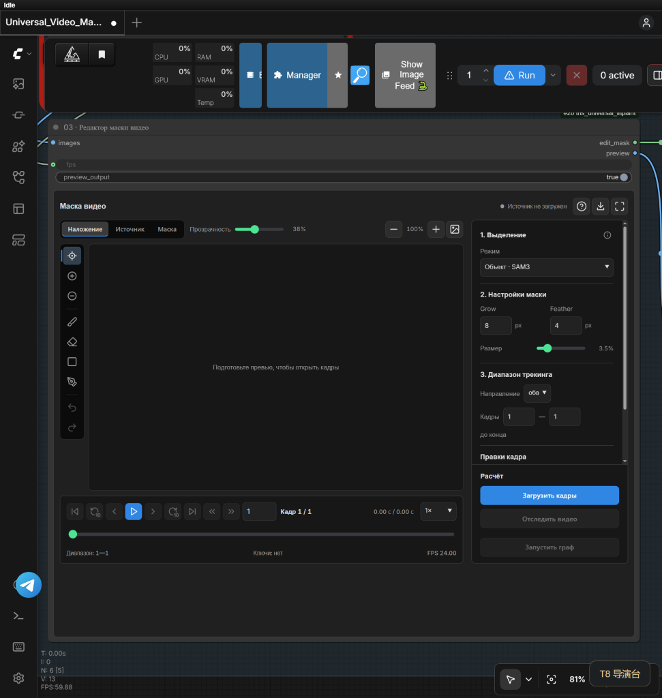
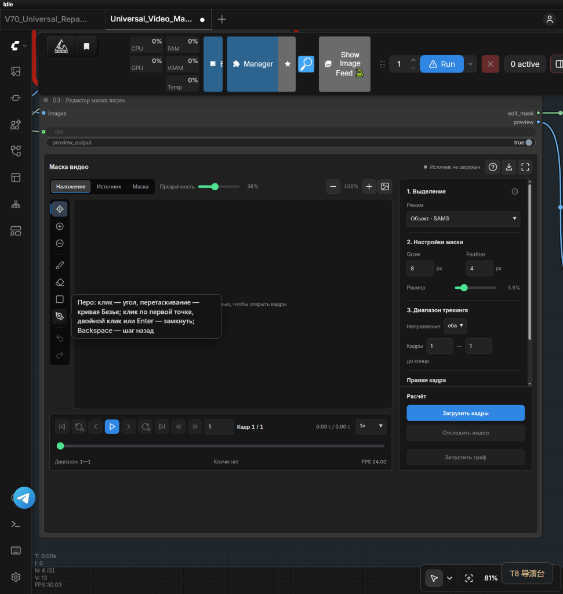
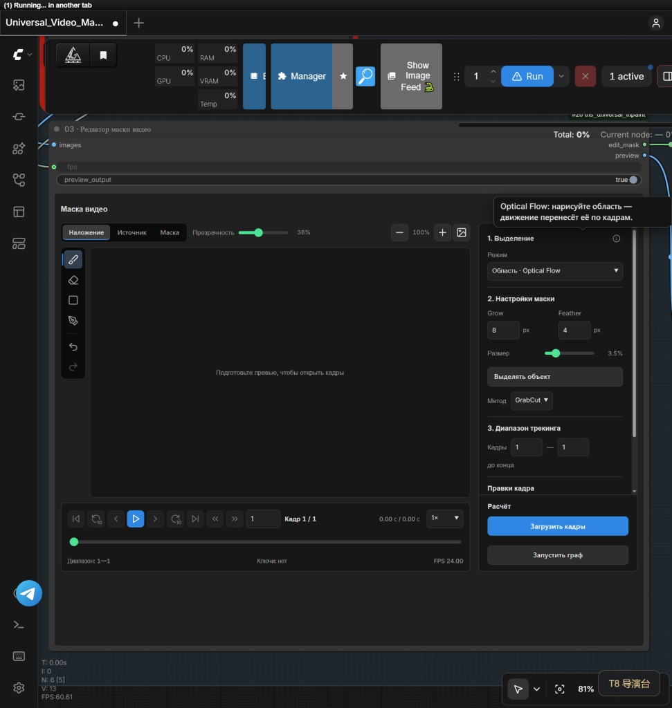
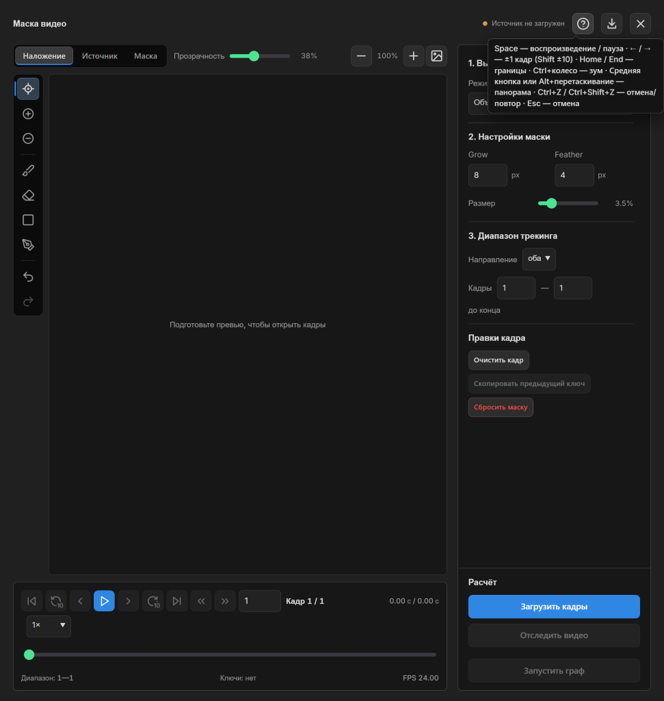
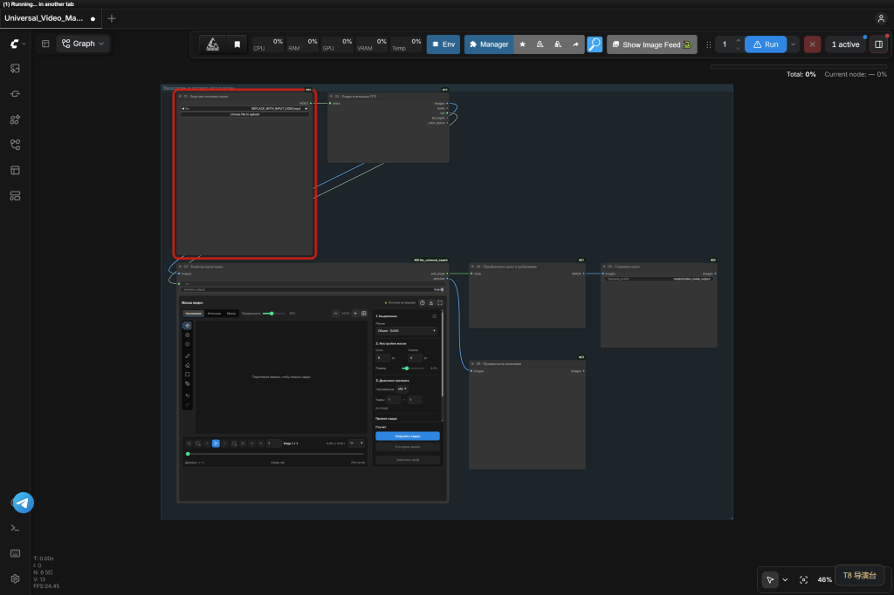

# ComfyUI Video Mask Editor

[Русский](README.md) · [Illustrated walkthrough (RU)](docs/USER_GUIDE_RU.md) · [Node reference (RU)](docs/NODES_RU.md) · [Installation](docs/INSTALL.md)

Interactive video object segmentation and mask tracking editor node for ComfyUI — **`THSUniversalMaskEditor`** (*Video Mask Editor*). Supports two-step **SAM3** object tracking (up to 8 independent objects per clip), CPU **Optical Flow** region tracking, **Keyframes**, and **Static** masks, manual refinement with brush, eraser, rectangle, and Bezier **Pen** tool, edge `Grow` / `Feather`, and a standalone ComfyUI workflow outputting `MASK` and `IMAGE`.

> This repository is scoped exclusively to `THSUniversalMaskEditor` and its ready-to-run workflow [`workflows/Universal_Video_Mask_Editor.json`](workflows/Universal_Video_Mask_Editor.json).



## Feature overview

- **Four strictly separated tracking modes**:
  - **Object · SAM3 (`sam3`)**: Explicit two-step GPU segmentation — click/box objects on a seed frame, preview just that frame (**«Рассчитать кадр» / Calculate frame**), refine with `+` / `−` points (or right-click removal), and explicitly track forward, backward, or both (**«Отследить видео» / Track video**) for up to 8 independent objects.
  - **Region · Optical Flow (`optical_flow`)**: CPU motion propagation via OpenCV from painted masks or rectangles, with optional object cutout (**«Выделять объект»**: CPU `GrabCut` or `SAM3`) for rectangles.
  - **Manual Keyframes (`keyframes`)** & **Static Mask (`static`)**: Deterministic CPU modes with zero neural-network dependencies.
- **Left vertical tool rail & Bezier Pen tool (`Перо`)**:
  - Precision **Pen (`Перо`)**: click places sharp corners, click-and-drag pulls symmetric cubic Bezier handles (continuing smoothly even outside the image frame), live rubber-band curve and anchor preview with snap-to-close ring on the first anchor, `Backspace`/`Delete` to pop the last anchor, `Enter` / double-click / click-first-anchor to close, and `Esc` to abort. Completed closed paths serialize losslessly as normalized mask polygons.
  - **Brush / Eraser / Rectangle** plus 80-step Undo/Redo history (`Ctrl+Z` / `Ctrl+Shift+Z` / `Ctrl+Y`) that preserves approved SAM3 seed tokens across stroke refinements.
- **Hover-only Top-Layer tooltips & zero-shift UI**:
  - All guidance lives strictly on hover/keyboard focus via a native `popover="hint"` tooltip (`650ms` initial delay, `180ms` warm transition across neighboring controls), covering disabled action buttons (`.ths-tip-wrap`), vertical rail tools (`inline-end`), mode info (`ⓘ`), and shortcut help (`?`).
  - No permanent inline hint bars, mode helper paragraphs, queue captions, or `<details>` accordions exist in normal layout flow; canvas view switching, tool switches, hover tips, and frame scrubbing produce `0px` layout shift.
- **Viewer, fullscreen `<dialog>`, and guardrails**:
  - `Наложение` (overlay) / `Источник` (source) / `Маска` (alpha matte) tabs, opacity slider (`0–100%`), zoom-under-cursor, middle-mouse / `Alt+drag` panning, timeline keyframe markers, source-mismatch recovery (`Start blank mask for new clip` / `Restore previous mask`), and redacted JSON debug export.







## Standalone workflow and node contract

[`workflows/Universal_Video_Mask_Editor.json`](workflows/Universal_Video_Mask_Editor.json) wires `LoadVideo` → `GetVideoComponents` → `THSUniversalMaskEditor` → `MaskToImage` → `SaveImage` + `PreviewImage`.



| Item | Signature | Purpose |
| --- | --- | --- |
| Node ID / Category | `THSUniversalMaskEditor` · `Universal Mask Editor` | Interactive video mask editor outputting `edit_mask` (`MASK`) and `preview` (`IMAGE`) |
| Required inputs | `images`, `mask_data`, `tracking_mode`, `grow` (`0–256`, default `8`), `feather` (`0–256`, default `4`), `start_frame`, `end_frame` | Video tensor, serialized vector/SAM3 state, tracking mode, edge post-processing, and frame range |
| Optional inputs | `fps` (`24.0`), `preview_output` (`true`) | Frame rate metadata and optional green-overlay `IMAGE` output |
| Outputs | `edit_mask` (`MASK`), `preview` (`IMAGE`) | Gated via `ExecutionBlocker` until a non-empty mask (and completed track in `sam3` mode) is ready |

## Keyboard shortcuts

- `Space`: Play / Pause · `←` / `→`: Step 1 frame (`Shift + ← / →`: ±10 frames) · `Home` / `End`: First / Last frame
- `Ctrl+Z` / `Ctrl+Shift+Z` / `Ctrl+Y`: Undo / Redo
- **Pen tool**: Click = corner, Click+Drag = cubic Bezier handle, Click 1st anchor / `Enter` / Double-click = close path, `Backspace`/`Delete` = remove last anchor, `Esc` = cancel open path
- `Ctrl/Meta + Wheel` inline or `Wheel` in fullscreen: Zoom at cursor · Middle-drag or `Alt/Shift + Drag`: Pan
- `Esc`: Close open tooltip, cancel active gesture, or close fullscreen modal `<dialog>`

## Install

1. Clone into `ComfyUI/custom_nodes/`:

   ```powershell
   cd custom_nodes
   git clone https://github.com/jimmorisedu-boop/ComfyUI-Universal-Inpaint.git
   cd ComfyUI-Universal-Inpaint
   ```

2. Install the CPU `editor` profile into the ComfyUI Python environment (protected by a `pip --dry-run` check that leaves your `torch` / CUDA packages untouched):

   ```powershell
   python scripts/setup.py install --profile editor --comfy-root "<COMFYUI_ROOT>" --apply
   ```

3. Restart ComfyUI and open `workflows/Universal_Video_Mask_Editor.json`. For GPU object tracking with SAM3, install the `sam3` profile and weights per [docs/INSTALL.md](docs/INSTALL.md) and [docs/MODELS.md](docs/MODELS.md).

## Development checks

```powershell
python -m pytest -q
node --test tests/*.test.mjs
npx -y modern-web-guidance@latest legacy-scan web
```

See [docs/DEVELOPMENT.md](docs/DEVELOPMENT.md) and [docs/EDITOR_DESIGN.md](docs/EDITOR_DESIGN.md) for architecture and frontend patterns.

- Maintainer: **jimmorisedu-boop**
- Repository: [jimmorisedu-boop/ComfyUI-Universal-Inpaint](https://github.com/jimmorisedu-boop/ComfyUI-Universal-Inpaint)
- License: **GPL-3.0-only** (`LICENSE`)
