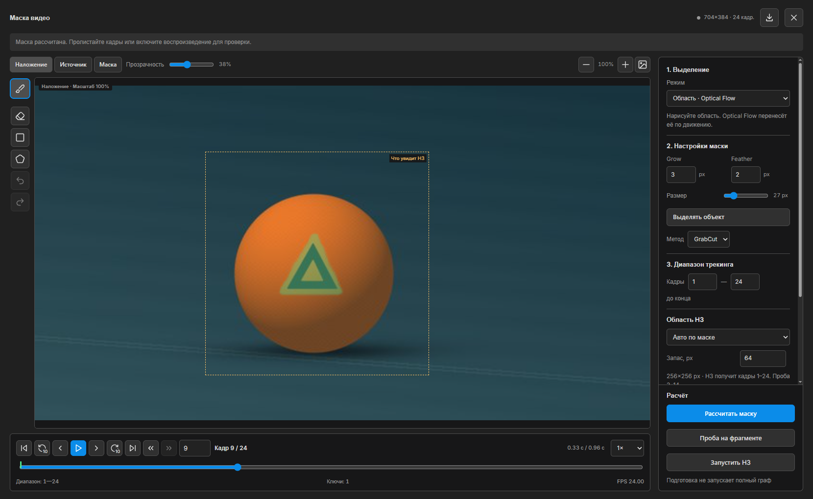
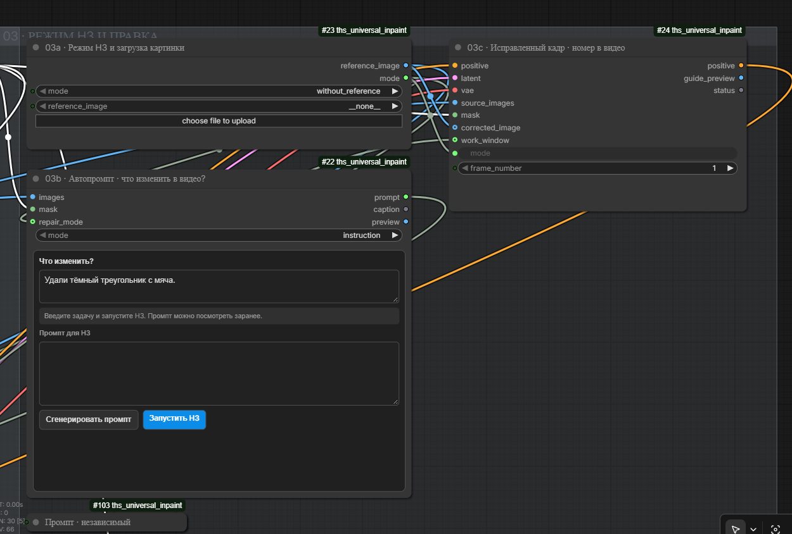
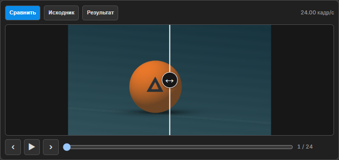

# Ноды Universal Inpaint в ComfyUI

После установки откройте библиотеку нод и найдите категорию **Universal Inpaint**. В русской локали новые ноды отображаются под названиями из этого справочника. В сохранённом графе ComfyUI показывает заголовки автора схемы, например **03a · Режим правки, картинка и заливка**. Под каждым заголовком ниже указан постоянный идентификатор ноды для сверки с JSON или сообщением об ошибке.

**Для первого видео** откройте готовый V70 и выберите исходник. В редакторе маски отметьте область правки, в 03a выберите способ замены и проверьте короткую пробу кнопкой **«Проба на фрагменте»**. Большинство служебных нод уже соединены. [Скачать схему V70](../workflows/V70_Universal_Repair_Workbench.json) · [Пройти пример со скриншотами](USER_GUIDE_RU.md)

## Выделение и проверка маски

### Редактор маски видео
`THSUniversalMaskEditor` · в V70 **03 · Редактор маски**

Подайте кадры из `GetVideoComponents` на `images`, частоту кадров — на `fps`. Нажмите **«Загрузить кадры»** и выберите кадр, где объект хорошо виден.

| Что хотите выделить | Действия |
| --- | --- |
| Человека или предмет | Выберите **«Объект · SAM3»**. Прицелом кликните по предмету и дождитесь цветной маски. Следующий клик прицелом добавит другой объект. Для уточнения активного объекта используйте **+** и **−**. Правый клик по маркеру удаляет точку, по выделенной области — объект. Проверьте опорный кадр и отдельно нажмите **«Отследить видео»**. Если начали с прямоугольника, сначала нажмите **«Рассчитать кадр»**. |
| Пятно или участок одежды | Выберите **«Область · Optical Flow»**, закрасьте участок или обведите полигоном и нажмите **«Рассчитать маску»**. Пролистайте кадры. Там, где выделение съехало, поправьте его кистью или ластиком и повторите расчёт. |
| Область в фиксированном месте | Выберите **«Неподвижная маска»**, нарисуйте её и задайте диапазон. Для нескольких вручную заданных положений выберите **«Ручные ключи»**. |

**Grow** расширяет выделение в пикселях, **Feather** смягчает край. На дальнейшую обработку подайте **edit_mask**. Выход **preview** показывает кадры для визуальной проверки. Зелёный цвет в редакторе показывает выделенную область, пунктирная рамка H3 — окружающий участок, который модель увидит для контекста.

## Задача для H3

### Выбор режима и изображения
`THSUniversalReferenceImage` · в V70 **03a**

Это переключатель для всей схемы. Его выход **mode** сообщает другим нодам, как использовать загруженное изображение. Выход **reference_image** передаёт само изображение.

| Режим в списке | Что сделать |
| --- | --- |
| `without_reference` | Оставьте файл `__none__` и введите задачу в 03b. Например, «Удали тёмный треугольник с мяча». |
| `with_reference` | Загрузите фото нужного предмета. Схема выделяет предмет на фото, вписывает его по пропорциям в отслеженную область и передаёт H3 также само фото. Удобнее всего кадр с одним предметом и различимым фоном. |
| `corrected_frame` | Загрузите отредактированный кадр того же видео в исходном разрешении. Укажите его номер в 03c. |

Например, чтобы заменить галстук брошью, выделите галстук целиком и добавьте кистью место под брошь. Короткая проба покажет её размер, положение и движение. Если на фото несколько предметов, сначала обрежьте его вокруг нужного. При неудачном отделении от фона H3 всё равно получает фото как референс. Для точного положения броши подготовьте один кадр с брошью на нужном месте и используйте режим исправленного кадра.

### Автопромпт для видео
`THSUniversalAutoPrompt` · в V70 **03b**

Подключите исходные **images**, маску **edit_mask → mask** и **mode → repair_mode** из 03a. В режиме **instruction** напишите по-русски, что должно измениться. Для перевода нужен профиль `instruction`. **«Сгенерировать промпт»** покажет английский текст прямо в ноде. **«Запустить H3»** отправит задачу на генерацию. В V70 текст из 03b управляет заменой в режиме `without_reference`.

Для собственного готового текста выберите **manual**. Для описания видимого окружения по кадрам выберите **auto** с локальной Florence-2. В этом режиме **max_frames** задаёт число кадров для анализа (1–3), **context_padding** — сколько окружения показать модели. Основной выход **prompt** идёт в H3, **caption** содержит описание при его наличии, **preview** служит для проверки. [Установка перевода и моделей](INSTALL_RU.md)

### Опора по исправленному кадру
`THSUniversalCorrectedFrameGuide` · в V70 **03c**

Например, вы вручную убрали надпись с кадра 27. В 03a выберите `corrected_frame` и загрузите эту картинку. В 03c укажите **frame_number = 27**. Нумерация начинается с **1** по исходному видео. На кадре должна быть маска. Для пробы выберите момент рядом с ним.

Нода берёт исходник, исправленную картинку и маску, вклеивает правку на выбранном кадре и добавляет его как опору H3 через входы **positive**, **latent** и **vae**. В **guide_preview** можно увидеть собранный кадр, в **status** — номер применённой опоры. В двух других режимах сигнал **positive** проходит дальше без этой опоры.

### Зафиксированный промпт
`THSUniversalPromptText` · в V70 **Промпт · независимый текст**

Используйте, если хотите несколько раз запустить генерацию с одной формулировкой. В ручном режиме 03b нажмите **«Зафиксировать»** либо в собственном графе введите готовый текст в **text** и соедините выход **prompt** со входом **prompt** ноды подготовки H3. Для новой задачи вернитесь в 03b и введите её в поле **«Что изменить?»**.

## Что получает модель

### Область обработки H3
`THSUniversalH3Window` · в V70 **Область H3**

Получает исходные кадры, маску и при наличии звук и FPS. Управляйте этой нодой из **«Область H3»** в редакторе маски. После расчёта маски выберите автоматическую рамку с запасом, рамку вручную или весь кадр. Для замены небольшого знака на ткани оставьте в рамке участок ткани вокруг знака. Чтобы изменить больше пикселей в результате, расширьте саму маску.

Выходы **images**, **mask** и **audio** содержат рабочий фрагмент. **work_window** сохраняет его положение в исходном видео для нод исправленного кадра, вклейки и сравнения. Кнопка пробы выбирает до 12 кадров правки, полный запуск — диапазон от первого до последнего кадра с маской.

### Подготовка кадров и маски для H3
`THSUniversalH3PadSource` · в V70 **04 · Паддинг H3**

Подключите кадры и маску рабочего фрагмента. Нода подгоняет размеры под сетку H3 и добавляет служебные кадры до допустимой длины `17 × n + 5`. В графе используйте **padded_images** для кодирования видео и **padded_mask** для ограничения генерации. Выход **original_count** понадобится после декодирования, чтобы убрать добавленный хвост.

В V70 решает задача из 03b. Для простой команды «Удали надпись» нода заполняет выделение по выбранному способу. Для однозначно указанного цвета, например «Сделай надпись красной», нода вклейки перекрашивает пиксели прямо по маске. Семплер пропускается, поэтому исходные тени и рисунок сохраняются. При сложной текстовой замене модель получает исходные кадры. При замене по фотографии схема освобождает место для нового предмета и передаёт H3 изображение из 03a. Если собираете схему вручную, соедините выход **source_edit** из 03b с одноимёнными входами подготовки кадров и вклейки. Из 03a подайте **reference_image** и **mode** на **replacement_image** и **repair_mode** подготовки кадров. Без этого соединения подготовкой управляет переключатель **prefill**.

В готовом V70 заливка выбирается в **03a**, и её выход **fill_strategy** подключён к одноимённому входу подготовки кадров. В самостоятельных и сохранённых старых графах эту настройку можно выбирать прямо в «Паддинг H3». [Скриншот и описание трёх вариантов](USER_GUIDE_RU.md#заливка-перед-h3)

### Подготовка звука для H3
`THSUniversalH3PadAudio` · в V70 **Технический · H3 audio pad**

Подключите кадры рабочего фрагмента для расчёта длительности и, если есть, его **audio**. Подайте **padded_audio** на аудиокодировщик. Для немого клипа нода создаёт служебную тишину. В готовом V70 настройки длины совпадают с настройками подготовки кадров. Для финального **CreateVideo** используйте исходные FPS и звуковую дорожку.

### Подготовка H3 для трёх режимов
`THSUniversalH3ReferenceConditioning` · в V70 **10 · H3 conditioning · три режима**

Соединяет CLIP, видео-VAE, текст и размеры подготовленного фрагмента с режимом из 03a. Обычно достаточно изменить 03a и 03b. Для `with_reference` здесь есть отдельный **reference_prompt** и размер референса **ref_image_size**. Начните с **match**. **max** оставляет больше деталей и требует больше ресурсов. Для `corrected_frame` нода подготавливает основу, а 03c добавляет исправленное изображение на выбранном кадре.

Выходы **positive** и **negative** задают условия генерации. **h3_latent** задаёт внутреннее представление H3 и подаётся в том числе на 03c.

### Подготовка H3 по тексту
`THSUniversalH3RepairConditioning` · отдельная нода для текстовых схем V69

Используйте в собственном графе или базовом V69, если нужен текстовый ремонт. Подключите **clip** и видео-**vae**, задайте **prompt**, **negative_prompt**, размеры и подготовленное число кадров. Для привязки к началу и концу включите **anchor_source_edges** и подайте кадры на **source_images**. По умолчанию привязка выключена. Нода возвращает **positive**, **negative** и **h3_latent**. В основном V70 эту работу выполняет нода подготовки для трёх режимов.

## После генерации

### Удаление служебных кадров
`THSUniversalTrimFrames` · в V70 **13 · Убрать synthetic H3 tail**

Соедините декодированные кадры с **images**, а **original_count** возьмите из подготовки кадров. При работе с рамкой это длина рабочего фрагмента до дополнения. Выход **images** передайте на **generated** ноды вклейки. Так служебные кадры не попадут в экспорт.

### Вклейка результата по маске
`THSUniversalMaskedComposite` · в V70 **14 · Exact source outside repair mask**

На **source** подайте полные исходные кадры, на **generated** — декодированный результат после удаления хвоста, на **repair_mask** — маску редактора. При обработке фрагмента подключите то же **work_window**. Выход **images** идёт одновременно на сравнение и сборку видео. Там, где маска равна нулю, до кодирования сохраняется точный исходный пиксель. Мягкий край маски смешивает исходник с генерацией.

### Сравнение исходника и результата
`THSUniversalRepairCompare` · в V70 **Сравнение**

Подайте исходные кадры на **source**, готовую вклейку — на **result**, исходную частоту — на **fps**. Для правильной нумерации кадров пробы подключите **work_window**. После пробы или полного запуска нажмите **«Сравнить»**, передвиньте разделитель прямо по изображению и пролистайте видео нижним ползунком. Кнопки **«Исходник»** и **«Результат»** показывают весь кадр. У ноды есть собственное окно просмотра. Файл готового видео сохраняет **SaveVideo** в группе экспорта.

## Если в графе отсутствует нода

Если ComfyUI сообщает о типе с префиксом **THSUniversal**, проверьте установку или обновление этого репозитория в `ComfyUI/custom_nodes`, перезапустите ComfyUI и обновите вкладку. Если отсутствует **MVEx_MaskToLatentSpace**, нужна зависимость **MaskVidExperiments**. Загрузчики моделей, **KSampler**, **GetVideoComponents**, **CreateVideo** и **SaveVideo** предоставляет ComfyUI. Профили H3, SAM3 и перевода устанавливают отдельно под выбранную задачу. [Установка на русском](INSTALL_RU.md) · [Зависимости схемы](DEPENDENCIES.md)
