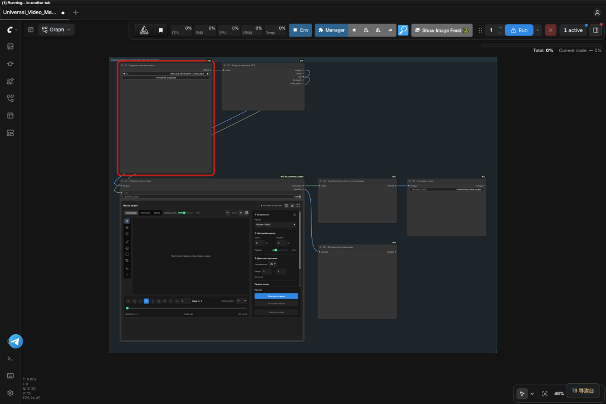
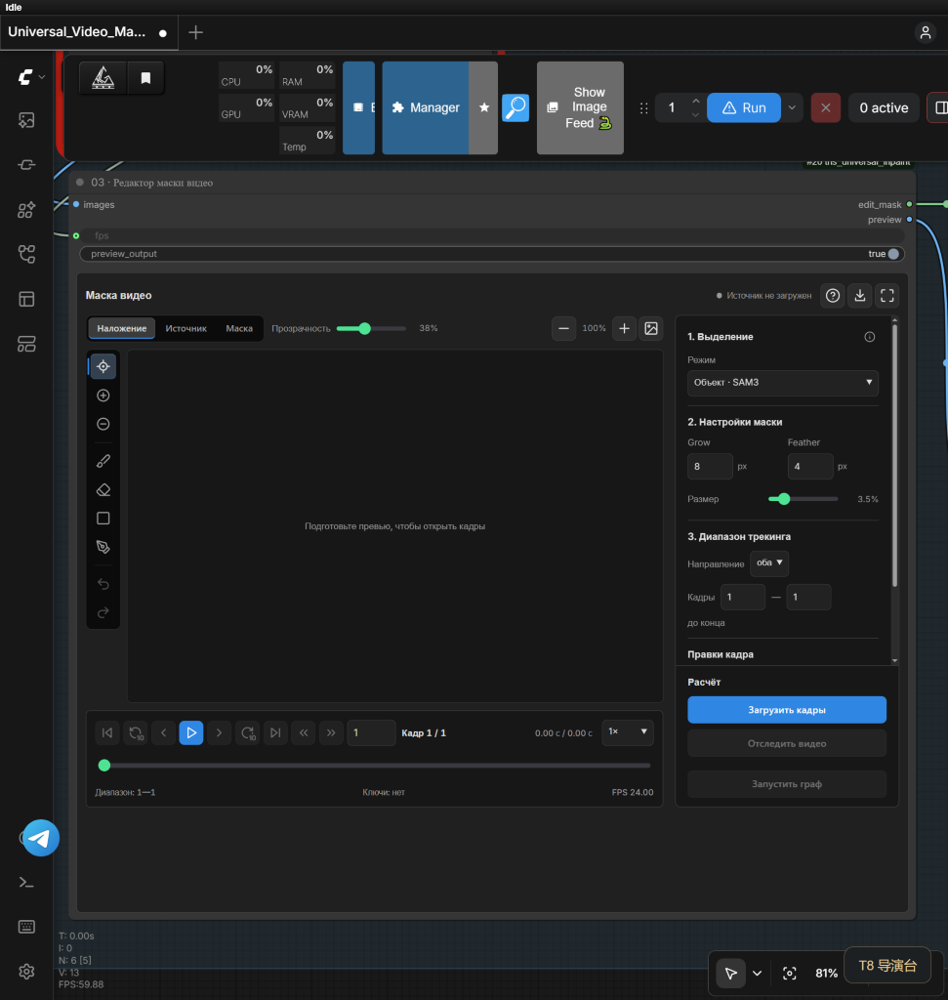
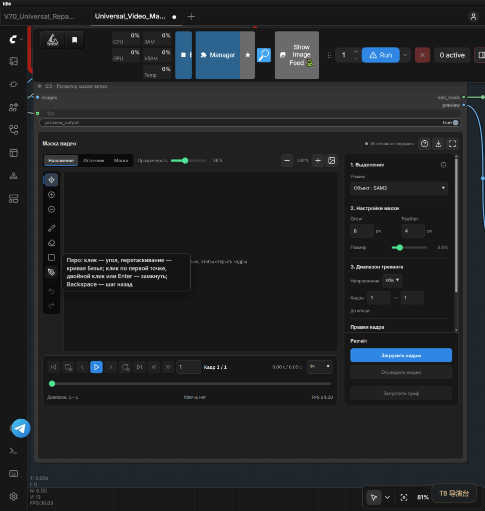
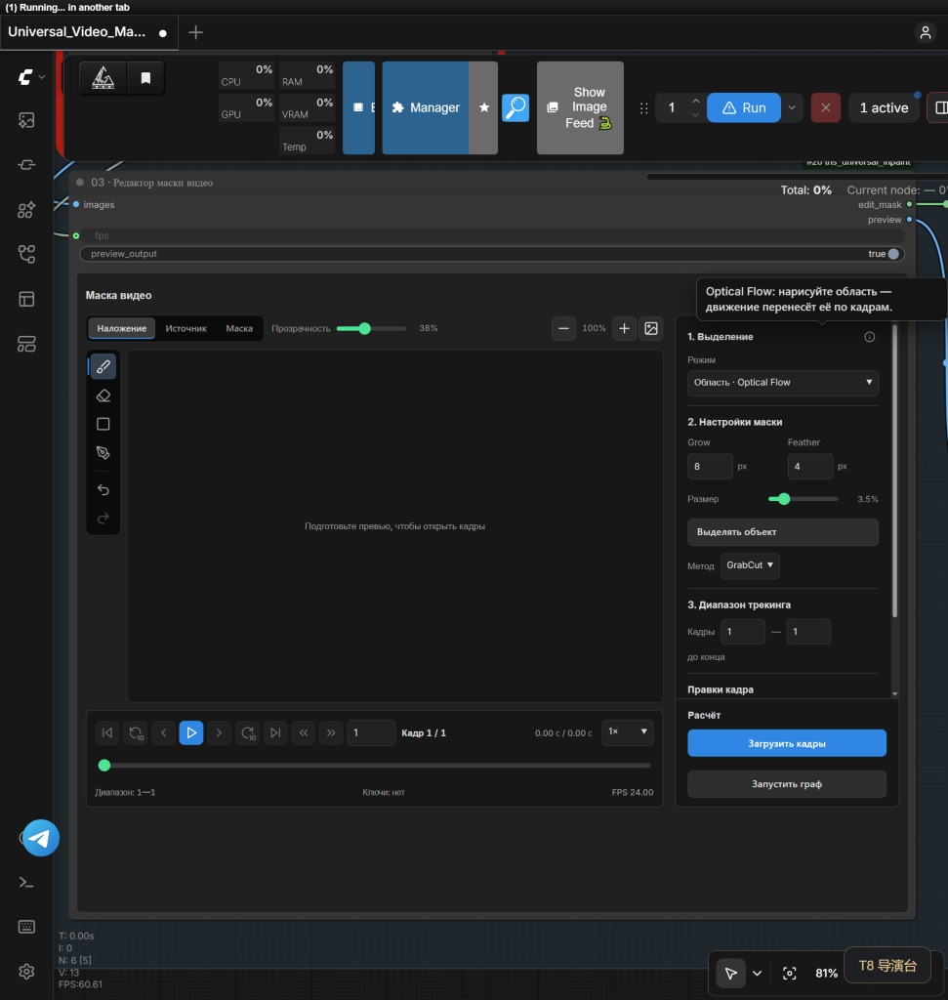
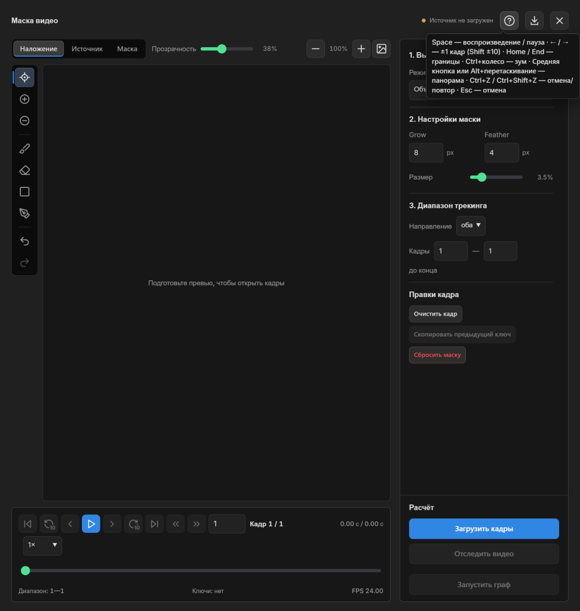

# Подробное руководство: Редактор маски видео (`THSUniversalMaskEditor`)

[Справочник входов и выходов](NODES_RU.md) · [Установка и подключение SAM3](INSTALL_RU.md) · [Архитектура интерфейса](EDITOR_DESIGN.md)

Нода `THSUniversalMaskEditor` встраивает полноценный покадровый видеоредактор масок прямо внутрь графа ComfyUI: от точечного нейросетевого трекинга до 8 объектов через **SAM3** до векторного **Пера Безье**, **Optical Flow**, **ручных ключевых кадров** и постобработки границ (`Grow` / `Feather`).

---

## 1. Подключите готовый граф

Откройте [`workflows/Universal_Video_Mask_Editor.json`](../workflows/Universal_Video_Mask_Editor.json) в ComfyUI:

1. В ноде **01 · Загрузить исходное видео (`LoadVideo`)** выберите ваш видеофайл из папки `ComfyUI/input`.
2. Узел **02 · Кадры и исходный FPS (`GetVideoComponents`)** автоматически передаст последовательность кадров и частоту `fps` в **`03 · Редактор маски видео`**.
3. Нажмите **«Загрузить кадры»** в редакторе: в очередь ставится только загрузка и кэширование превью кадров, а ноды сохранения/просмотра дальше по графу при этом блокируются (`ExecutionBlocker`) и не запускаются.

---

## 2. Обзор интерфейса и подсказки по наведению

Интерфейс ноды разделён на три зоны без лишних постоянных баннеров и «дёргающейся» разметки:

- **Шапка**: название, цветной индикатор состояния и параметры источника (`ширина×высота · кадры`), а также кнопки **`?` (шпаргалка горячих клавиш)**, экспорта debug-лога и полноэкранного режима **`Развернуть`**.
- **Верхняя полоса просмотра**: переключатель **`Наложение | Источник | Маска`**, ползунок **`Прозрачность`** (`0–100%`) и кнопки масштаба (`− / 100% / + / Вписать`).
- **Левая вертикальная панель инструментов**: инструменты SAM3 (в режиме `sam3`), инструменты ручного рисования (**Кисть**, **Ластик**, **Прямоугольник**, **Перо**) и **Отменить / Повторить**.
- **Правый инспектор**:
  - `1. Выделение`: выбор режима трекинга, кнопка `ⓘ` (описание режима) и переключатель **«Активный объект SAM3»** (появляется при выделении объектов).
  - `2. Настройки маски`: **`Grow`** (`0–256 px`), **`Feather`** (`0–256 px`), **`Размер`** кисти, а в не-SAM3 режимах — **`Выделять объект`** и **`Метод` (`GrabCut` / `SAM3`)**.
  - `3. Диапазон трекинга`: направление **`вперёд` / `назад` / `оба`** (для SAM3) и диапазон кадров `start_frame — end_frame`.
  - `Расчёт` *(зафиксирован снизу)*: **«Загрузить кадры» / «Рассчитать кадр»**, **«Отследить видео»**, **«Запустить граф»**.
- **Таймлайн под холстом**: кнопки покадровой и ±10 навигации, переход к прошлому/следующему ключу, прямой ввод кадра, скорость воспроизведения (`0.25×–2×`) и лента с зелёными отметками ключевых кадров.

> **Всплывающие подсказки по наведению**: подробная справка по любому инструменту, параметру или заблокированной кнопке (например, почему неактивна *«Запустить граф»*) появляется поверх интерфейса при паузе курсора **~650 мс** или при переходе с клавиатуры, не сдвигая макет ни на один пиксель и не мешая рисованию на холсте.

---

## 3. Выделение и трекинг объектов в SAM3 (`sam3`)

1. В разделе **1. Выделение** выберите **«Объект · SAM3»**.
2. Перемотайте таймлайн на удобный опорный кадр и нажмите **«Загрузить кадры»**.
3. Инструментом **«Выбрать объект»** (прицел) кликните внутри нужного объекта — редактор запустит быстрый расчёт **только этого кадра**.
   - Повторный клик **прицелом** по другому объекту добавит новый независимый объект (до 8 штук; переключение между ними доступно в списке **«Активный объект SAM3»**).
   - Либо выделите объект рамкой инструментом **«Прямоугольник»** и нажмите **«Рассчитать кадр»**.
4. Уточняйте маску активного объекта:
   - **+** (*«Добавить к объекту»*) — включить пропущенную часть объекта.
   - **−** (*«Исключить из объекта»*) — убрать лишний фон/участок.
   - **Правый клик** по маркеру точки удаляет эту точку; правый клик по маске вдали от точек удаляет весь объект целиком.
5. Выберите направление (**`вперёд`**, **`назад`** или **`оба`**) и диапазон кадров, затем нажмите **«Отследить видео»**.
6. Пролистайте клип по кадрам. При необходимости подправьте отдельные кадры **кистью**, **ластиком**, **прямоугольником** или **пером** — ваши ручные правки сохранятся слоем поверх трека SAM3.

---

## 4. Инструмент «Перо» (кривые Безье и точные контуры)

Инструмент **«Перо»** (четвёртая кнопка рисования на левой панели) заменяет простой полигон и позволяет обводить сложные контуры:

- **Угловая вершина**: обычный клик ставит точку с прямыми отрезками.
- **Плавная кривая Безье**: зажмите кнопку мыши и потяните — вытянутся симметричные касательные ручки кривизны (ручки можно тянуть даже за границы изображения).
- **Замыкание контура** *(любым удобным способом)*:
  - кликните по первой точке (при приближении ≤ 10 px вокруг неё загорится зелёное кольцо привязки);
  - сделайте **двойной клик** на последней вершине;
  - нажмите **`Enter`**.
- **Правка открытого пути**: **`Backspace` / `Delete`** удаляет последнюю поставленную вершину; **`Esc`** отменяет весь незавершённый путь.

---

## 5. Режимы CPU: Optical Flow, Ручные ключи и Неподвижная маска

- **Область · Optical Flow (`optical_flow`)**: нарисуйте область **кистью**, **прямоугольником** или **пером** на одном или нескольких кадрах и нажмите **«Загрузить кадры»** — OpenCV перенесёт область по движению. Если нужно выделять объект по прямоугольнику автоматически, включите кнопку **«Выделять объект»** и выберите метод **`GrabCut`** (CPU) или **`SAM3`**.
- **Ручные ключи (`keyframes`)**: используйте в сценах с быстрыми склейками или ручной покадровой маской — каждый кадр удерживает ближайший ключевой кадр без расчёта оптического потока.
- **Неподвижная маска (`static`)**: нарисуйте маску один раз — она одинаково применится ко всему диапазону `start_frame..end_frame` (логотипы, текст, статичные детали).

---

## 6. Полноэкранный режим, восстановление источника и запуск графа

- Нажмите кнопку **`Развернуть`** в правом верхнем углу, чтобы открыть полноэкранный модальный редактор `<dialog>` — все кисти, зум, таймлайн, раздел **`Правки кадра`** (`Очистить кадр`, `Скопировать предыдущий ключ`, `Сбросить маску`) и история правок остаются активными.
- Если входное видео изменилось (число кадров, разрешение или содержимое), редактор заблокирует старую маску и покажет панель выбора прямо поверх кадра: **«Начать маску для нового клипа»** (с сохранением резервной копии) или **«Вернуть прежнюю маску»**.
- Когда маска на всех нужных кадрах готова, нажмите **«Запустить граф»** — нода снимет блокировку и передаст готовый тензор `edit_mask` (`MASK`) и превью `preview` (`IMAGE`) в последующие ноды (`MaskToImage` → `SaveImage` или ваш инпейнт/композитинг-пайплайн).

## 7. Горячие клавиши

- `Space` — воспроизведение / пауза.
- `←` / `→` — переход на ±1 кадр (`Shift + ← / →` — ±10 кадров).
- `Home` / `End` — первый / последний кадр.
- `Ctrl + Z` / `Ctrl + Shift + Z` / `Ctrl + Y` — отмена и повтор правок.
- `Ctrl / Meta + колесо` внутри ноды (или просто `колесо` в полном экране) — зум под курсором.
- Зажатая средняя кнопка мыши или `Alt / Shift + перетаскивание` — панорамирование кадра.
- `Esc` — закрыть открытый тултип, отменить текущее рисование или выйти из полноэкранного окна.
