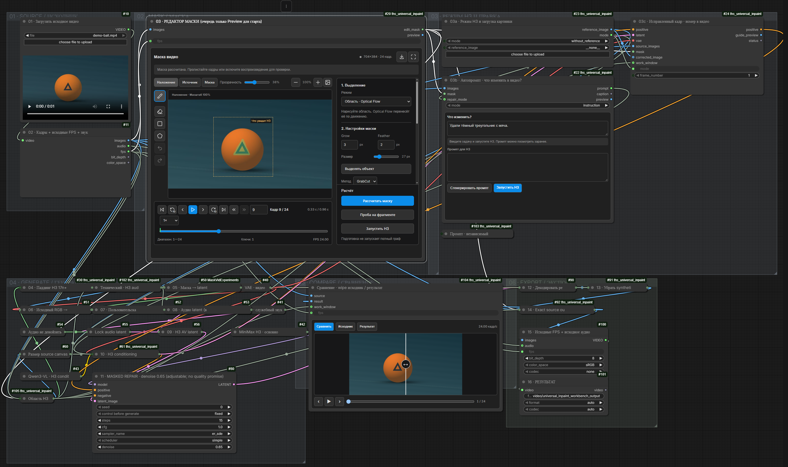
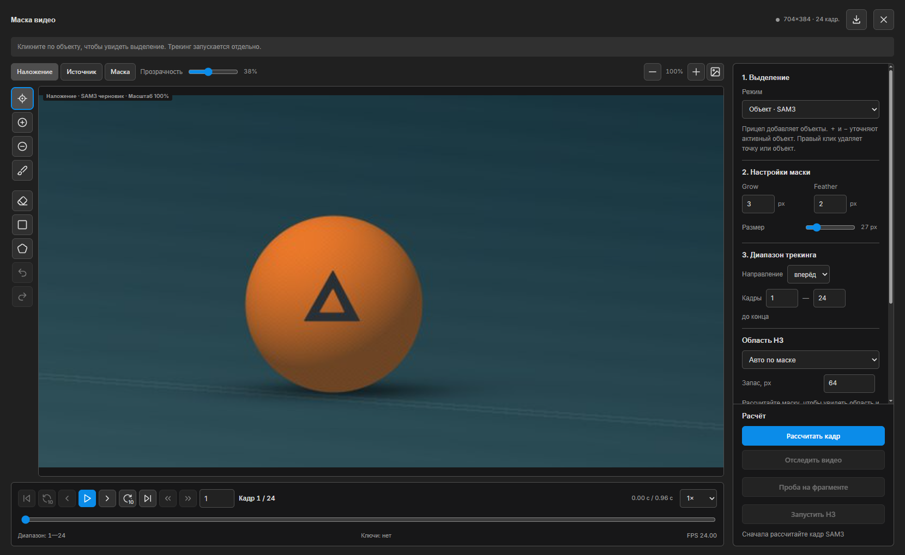
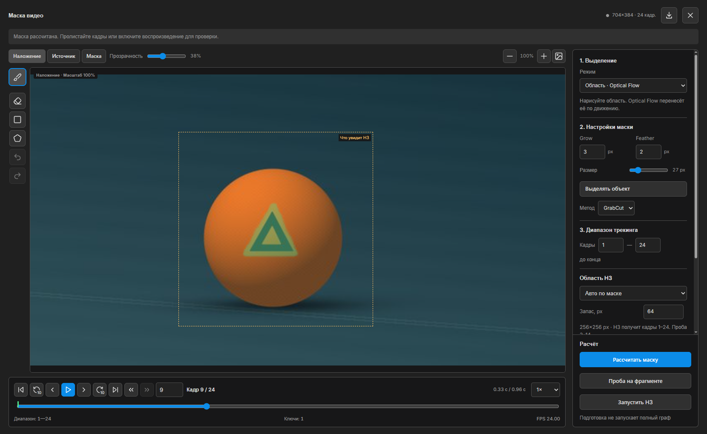
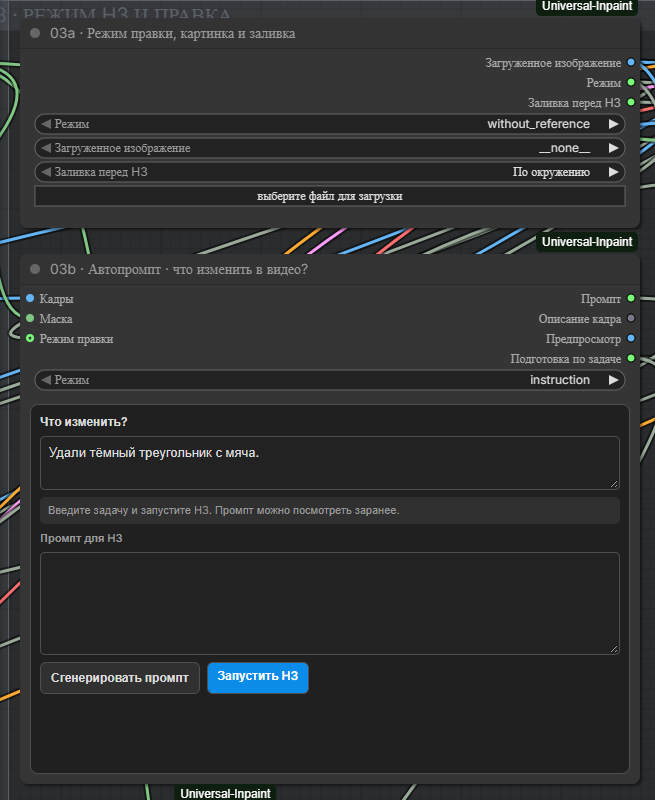
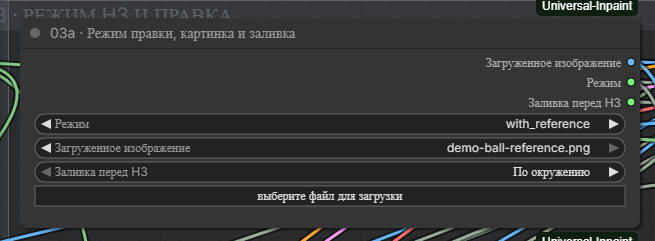
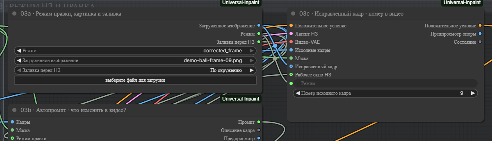
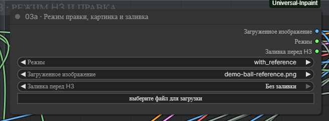

# Как пользоваться Universal Inpaint V70 в ComfyUI

[Справочник нод с назначением, входами и выходами](NODES_RU.md)

V70 изменяет выбранный участок видео. В редакторе маски укажите, **где** нужна правка. В группе «Режим H3 и правка» выберите, **что** должно появиться на этом месте. Перед экспортом можно рассчитать короткую пробу и сравнить её с исходником.

**Для первого запуска** понадобится ComfyUI с профилями `editor` и `h3`. Для выбора объекта по клику добавьте `sam3`, для задачи на русском языке — `instruction` с моделью перевода. Если пока установили только редактор, маску можно опробовать в отдельном графе `V69_Universal_Masked_Repair_MASK_ONLY.json`. [Установка, модели и проверка окружения](INSTALL_RU.md)

## 1. Откройте схему и выберите видео

Откройте меню **Workflows → Open** или перетащите JSON на холст ComfyUI. Используйте файл из текущей версии пакета. [Открыть V70 в репозитории](../workflows/V70_Universal_Repair_Workbench.json)

| Где работать | Что сделать |
| --- | --- |
| **01 · Source** | В `LoadVideo` выберите свой ролик вместо `REPLACE_WITH_INPUT_VIDEO.mp4`. Файлы для загрузчика находятся в каталоге `ComfyUI/input`. |
| **02 · Mask** | Откройте редактор маски. Выберите режим, загрузите кадры, выделите область и рассчитайте маску по видео. |
| **03 · Режим H3 и правка** | В **03a** выберите источник правки. Для текста используйте **03b**. Для исправленного кадра укажите номер в **03c**. |
| **04 · Generate** | При первом запуске проверьте модели в загрузчиках. Выбранные файлы должны соответствовать установленным H3, CLIP и двум VAE. |
| **05 · Compare** | Здесь появляются пробный фрагмент и результат полного запуска. Передвигайте границу сравнения прямо по кадру. |
| **06 · Export** | В `SaveVideo` задаётся префикс выходного файла. По умолчанию полный запуск сохраняет видео в `ComfyUI/output/video/`. |

### Первый проход на примере

На скриншотах — короткий учебный ролик с движущимся оранжевым мячом. Задача — убрать тёмный треугольник. Для такой правки достаточно выделить сам знак и оставить вокруг него оранжевую поверхность для контекста.

1. В редакторе выберите **«Область · Optical Flow»** и нажмите **«Загрузить кадры»**. На кадре, где знак хорошо виден, обведите его полигоном или закрасьте кистью.
2. Нажмите **«Рассчитать маску»**. Перейдите на другой кадр и проверьте, что зелёное выделение движется со знаком.
3. В **03a** оставьте `without_reference`. В **03b → Что изменить?** введите «Удали тёмный треугольник с мяча». Кнопка **«Сгенерировать промпт»** показывает английский текст, который получит H3.
4. Выберите на таймлайне момент с заметным движением. Нажмите **«Проба на фрагменте»** и откройте результат в сравнении. Если виден остаток знака, вернитесь на этот кадр, поправьте маску и повторите пробу.
5. Когда правка подходит, нажмите **«Запустить H3»**. Полный ролик сохранится с исходной длительностью и частотой кадров.

## 2. Выберите способ выделения

В опубликованном V70 выбран **Optical Flow**. Переключатель находится в редакторе маски справа, в разделе **«1. Выделение → Режим»**. Для крупного кадра нажмите значок разворачивания в правом верхнем углу.

| Режим | Когда использовать |
| --- | --- |
| **Объект · SAM3** | Человек, предмет одежды или другой узнаваемый объект. Сначала выбираете его по клику или рамкой на одном кадре, затем SAM3 сам отслеживает объект по видео. |
| **Область · Optical Flow** | Надпись, пятно или участок текстуры. Вы рисуете маску, затем Optical Flow переносит её по движению пикселей. |
| **Ручные ключи** | Для каждого участка времени нужна своя форма. Кадр получает маску ближайшего ручного ключа. |
| **Неподвижная маска** | Область остаётся на одном месте экрана, например логотип в углу. Нарисованная маска повторяется в выбранном диапазоне. |

## 3. Выберите и отследите объект в SAM3

1. Загрузите кадры. В режиме **«Объект · SAM3»** выбран инструмент
   **«Выбрать объект»** (прицел). Кликните внутри каждого нужного предмета
   на одном опорном кадре. Редактор объединяет до восьми объектов.
2. Дождитесь цветного выделения. Клик запускает только SAM3-предпросмотр
   текущего кадра. Трекинг и H3 автоматически не запускаются.
3. Выберите цель в списке **«Активный объект SAM3»**. **«Добавить к объекту» (+)**
   уточняет пропущенную часть, **«Исключить из объекта» (−)** убирает лишнее
   из активного объекта. Предпросмотр обновляется после каждой точки.
   Правый клик по маркеру удаляет точку. Правый клик внутри маски удаляет
   объект. При пересечении масок приоритет у активного объекта под курсором.
   Удаление последней положительной точки также удаляет её объект.
   Первый клик может занять больше времени из-за загрузки модели. Следующие
   клики используют уже открытые кадры и обновляют маску поверх них.
4. Когда выделение подходит, выберите направление и диапазон и нажмите
   **«Отследить видео»**. До успешного предпросмотра эта кнопка недоступна.
5. Просмотрите маски по кадрам. Кисть и ластик исправляют маску локально;
   эти правки сохраняются при повторном трекинге. Затем можно запустить H3.

Прямоугольник тоже доступен: обведите объект и нажмите **«Рассчитать кадр»**.
Само рисование рамки расчёт не запускает. Этой же кнопкой можно повторить
предпросмотр после изменения настроек или отмены точки.

Если native SAM3 недоступен, редактор показывает явную ошибку. Не считайте
это успешным трекингом и не запускайте H3; для CPU используйте Optical Flow
или mask-only граф.

## 4. Нарисуйте или поправьте маску

Инструменты Add/Erase, прямоугольник, polygon, Undo/Redo и Clear работают на
выбранном кадре. `Grow` расширяет маску, `Feather` смягчает край. Исходные
пиксели вне маски должны оставаться неизменными после композитинга.

При смене исходного клипа старые маски блокируются до явного восстановления
или очистки. Это защита от применения истории одного видео к другому.

### Optical Flow

1. Выберите **«Область · Optical Flow»** и загрузите кадры.
2. На опорном кадре закрасьте область кистью или задайте её фигурой.
3. Укажите начало и конец диапазона, нажмите **«Рассчитать маску»**.
4. Просмотрите результат по таймлайну. При смещении маски поправьте её кистью
   или ластиком на нужном кадре и повторите расчёт. Сохранённые ручные правки
   учитываются при повторном запуске.

Optical Flow оценивает движение изображения, поэтому на перекрытиях, резких
склейках и сильном размытии нужны дополнительные ручные правки. Для целого
движущегося объекта начните с режима SAM3.

### Инструменты и настройки

Наведите мышь на иконку, чтобы увидеть её название и подсказку.

| Элемент | Действие |
| --- | --- |
| Выбрать объект (прицел) | SAM3: клик добавляет объект в общую маску на опорном кадре. |
| Добавить к объекту (+) | SAM3: положительная точка уточняет выбранный объект; предпросмотр обновляется. |
| Исключить из объекта (−) | SAM3: отрицательная точка исключает лишнее; сначала выберите объект прицелом. |
| Кисть / Ластик | Добавить / убрать область маски на выбранном кадре. В SAM3 правки накладываются на результат трекинга. |
| Размер | Диаметр кисти или ластика; отображается в пикселях исходного кадра. |
| Прямоугольник | Рамка для SAM3 либо прямоугольная маска в ручном режиме. |
| Полигон | Задать вершины щелчками, завершить Enter. |
| Выделять объект | В ручных режимах превращает новый прямоугольник в запрос выделения объекта. При выключении прямоугольник заполняется целиком. |
| Метод: GrabCut / SAM3 | GrabCut отделяет объект по цветам без нейросетевой модели; рамка должна включать немного фона. SAM3 использует локальную модель. Нажмите «Рассчитать маску» для результата. Для полноценного SAM3-трекинга выберите основной режим «Объект · SAM3». |
| Grow | Расширить границу маски на указанное число пикселей, 0–256. |
| Feather | Смягчить край после расширения, 0–256 пикселей. |
| Направление | SAM3: вперёд, назад или в обе стороны от рассчитанного опорного кадра. |
| Диапазон | Первый и последний обрабатываемые кадры включительно; в интерфейсе счёт начинается с 1. |
| Отменить / Повторить | Перемещаться по истории правок: Ctrl+Z, Ctrl+Shift+Z или Ctrl+Y. |
| Очистить кадр | Очистить выбранный кадр. Если это опорный кадр SAM3, выберите объект заново кликом или рамкой. |
| Скопировать предыдущий ключ | Скопировать правки ближайшего предыдущего ключа в текущий кадр. |
| Сбросить маску | Удалить маску всего клипа, сохранив загруженный источник. |

После изменения диапазона, Grow, Feather или рисунка обновите расчёт и
проверьте превью перед генерацией.

### Просмотр, навигация и зум

| Элемент | Действие |
| --- | --- |
| Наложение / Источник / Маска | Цветная маска поверх видео / чистое видео / только маска. |
| Прозрачность | Меняет видимость наложения, не силу маски в генерации. |
| Развернуть / закрыть | Открыть большой редактор / вернуться в ноду; Esc закрывает большой редактор. |
| Колесо в большом редакторе | Зум вокруг курсора. Внутри ноды используйте Ctrl+колесо. |
| Зажатое колёсико + движение | Перемещение увеличенного кадра. |
| − / + / Вписать | Уменьшить / увеличить масштаб / показать весь кадр и сбросить смещение. |
| Первый / последний кадр | Home / End. |
| Предыдущий / следующий | ← / →; с Shift переход на 10 кадров. |
| Воспроизведение / пауза | Space. Скорость 0.25×–2× влияет только на просмотр. |
| Предыдущий / следующий ключ | Перейти к кадру с ручным ключом. |
| Номер кадра | Ввести номер и нажать Enter. |
| Таймлайн и метки | Перетащить ползунок или щёлкнуть метку ключевого кадра. |
| Время и FPS | Информация о позиции и частоте кадров источника. |

Горячие клавиши работают, когда фокус находится в редакторе; поля ввода
сохраняют обычное поведение. Во время воспроизведения поставьте паузу для рисования.

### Расчёт, восстановление и диагностика

Во время расчёта над кадром виден текущий этап. SAM3 и Optical Flow показывают
число обработанных кадров и примерный остаток времени, когда накопилось
достаточно данных о скорости. При подготовке отображается прошедшее время.

| Кнопка | Когда использовать |
| --- | --- |
| Загрузить кадры | Подготовить источник для просмотра и рисования. |
| Рассчитать маску | Обновить предпросмотр ручной маски и Optical Flow без генерации H3. |
| Рассчитать кадр | Повторить предпросмотр SAM3 или рассчитать выделение по рамке. Клик прицелом и точки +/− запускают этот предпросмотр автоматически. |
| Отследить видео | Отдельно запустить SAM3 на выбранном диапазоне после успешного расчёта кадра. |
| Отменить расчёт | Отменить свой запрос, если версия ComfyUI поддерживает адресную отмену. |
| Проба на фрагменте | Запустить H3 для короткого фрагмента вокруг текущей позиции. Результат появится в сравнении. |
| Запустить H3 | Запустить полный подключённый граф генерации после проверки маски. Для этого нужен H3-workflow. |
| Начать маску для нового клипа | Принять смену источника и начать пустую маску; прежняя сохраняется для восстановления. |
| Вернуть прежнюю маску | Восстановить сохранённую маску и настройки, затем вернуть прежнее видео в LoadVideo. |
| Скачать debug-лог | Получить журнал действий, ошибок и размеров редактора для разбора проблемы. Перед публикацией проверьте его на личные данные. |
| Подсказки | Открыть пояснения к режимам; все настройки остаются в основном редакторе. |

## 5. Настройте рамку «Что увидит H3»

После расчёта маски пунктирная рамка «Что увидит H3» показывает участок исходника, который получит модель. В режиме «Авто по маске» одна рамка охватывает движение за весь диапазон с запасом 64 px с каждой стороны. Если прямоугольник с запасом занимает 85% площади исходника или больше, авторежим выбирает весь кадр. Запас даёт модели контекст. Область вклейки задаёт цветная маска.

В блоке «Область H3» можно изменить запас, выбрать «Весь кадр» или «Рамка вручную». Два угловых маркера работают мышью и стрелками. Shift со стрелкой сдвигает угол на 16 пикселей. Рамка всегда включает маску.

Поставьте курсор на нужный кадр и нажмите **Проба на фрагменте**. H3 рассчитает до 12 кадров вокруг него с текущими настройками генерации и той же рамкой, что у финала. Результат открывается в ноде сравнения. Для режима исправленного кадра выберите фрагмент рядом с опорным кадром.

**Запустить H3** обрабатывает от первого до последнего кадра с маской. К пробе и финалу добавляется до четырёх исходных кадров по краям для контекста. Нода вклеивает результат в исходные координаты. Экспорт сохраняет исходную длительность, частоту кадров и звуковую дорожку.

Например, если нужно убрать только печать на ткани, увеличьте запас, чтобы H3 увидел окружающую текстуру. Если требуется заменить короткую причёску на длинную, закрасьте и место для новых волос. Увеличение одного запаса оставит прежнюю границу вклейки.

## 6. Выберите источник правки H3

Сначала рассчитайте маску. Затем в группе **«03 · Режим H3 и правка»** выберите режим в ноде **«03a · Режим правки, картинка и заливка»**. Один и тот же редактор маски работает во всех трёх режимах.

### По тексту · without_reference

1. В **03a → mode** выберите **without_reference**.
2. В **03b → Что изменить?** напишите задачу, например «Удали тёмный треугольник с мяча». Поле включает режим `instruction`. Для русского текста установите профиль `instruction` и локальную модель перевода. [Инструкция по установке](INSTALL_RU.md)
3. Нажмите **«Сгенерировать промпт»**, если хотите прочитать английский текст для H3. Для проверки видео нажмите **«Проба на фрагменте»** в редакторе маски.
4. Когда результат подходит, нажмите **«Запустить H3»** в 03b или в редакторе маски.

Для команды «Сделай галстук красным» схема перекрашивает маску по светотени исходной ткани и пропускает семплер H3. Для удаления и сложных правок используется H3. В 03b режим `manual` принимает готовый промпт, а `auto` описывает окружение маски с помощью локальной модели Florence-2/PromptGen.

### По фотографии · with_reference

1. В **03a → mode** выберите **with_reference**.
2. Нажмите **«Загрузить файл»** (`choose file to upload`) в той же ноде. Выберите фото одного хорошо видимого предмета или материала.
3. Маска должна покрывать старый предмет и место, которое займёт новый. Запустите пробу на кадре, где хорошо видны границы и движение объекта.

Фото задаёт внешний вид предмета. Задачу в 03b можно оставить пустой. Чтобы описать положение или масштаб предмета, откройте ноду **«10 · H3 conditioning · три режима»** и измените **reference_prompt**. Оставьте тег `<Picture 1>`, который связывает текст с загруженным фото.

### По исправленному кадру · corrected_frame

1. Возьмите кадр из исходного видео, например девятый, и сделайте на нём правку в графическом редакторе. Сохраните полное исходное разрешение и положение изображения.
2. В **03a → mode** выберите **corrected_frame**. Загрузите исправленный кадр в ту же ноду.
3. В **03c · Исправленный кадр → frame_number** укажите номер этого кадра в исходном ролике. Первый кадр имеет номер **1**.
4. Проверьте маску на опорном кадре и запустите пробу рядом с ним. Проба должна включать этот кадр.

Этот режим помогает задать точное положение, размер и вид правки на одном кадре. H3 использует исправленное изображение как опору для остальных кадров внутри маски.

Если соседние кадры постепенно возвращаются к исходнику, поднимите `denoise` в **KSampler** и повторите пробу. В проверке с красным галстуком `0.65` удержал цвет около опорного кадра, а `1.0` перенёс его на все 12 кадров пробы.

### Заливка перед H3

В ноде **03a · Режим правки, картинка и заливка** откройте список **«Заливка перед H3»** под выбором изображения.

| Что выбрать | Что получает H3 |
| --- | --- |
| **По окружению** | Выделение заполняется цветами соседних пикселей. Начните с этого варианта для удаления предмета и восстановления фона. Это исходная настройка V70. |
| **Нейтральный серый** | Выделение заполняется цветом **#808080**. Попробуйте его, если заливка по окружению втянула в маску посторонние цвета. В пробе проверьте, ушёл ли серый силуэт. |
| **Без заливки** | H3 получает исходные пиксели внутри маски. В режиме фото изображение остаётся референсом модели. Для замены по фото попробуйте этот вариант, если подготовленная заливка проступает в результате. |

Выбор применяется к команде удаления в режиме `instruction` и к замене по фото. При двух вариантах с заливкой режим фото также помещает вырезанный предмет в область маски перед генерацией. Для исправленного кадра, прямой перекраски и обычной правки по промпту схема использует свои способы подготовки.

На галстуке удаление получилось чище с окружением. Для замены галстука цветком удачной оказалась проба **«Без заливки»** с `denoise 0.85` в KSampler. Начинайте с короткой пробы на своём видео.

Если в 03a нет списка, обновите пакет нод и откройте новый файл V70 из репозитория после перезапуска ComfyUI. В ранее сохранённых графах выбор может оставаться в ноде «Паддинг H3». Самый простой способ перенести настройки — открыть новый V70 и выбрать источник, режим и маску заново.

## 7. Проверьте пробу и сохраните видео

**Проба на фрагменте** использует настройки H3, выбранный режим и ту же пространственную рамку, что полный запуск. Перед расчётом редактор показывает номера кадров пробы. После расчёта в ноде сравнения проверьте несколько кадров подряд. Обратите внимание на мягкий край маски, изменение текстуры и моменты, когда другой предмет проходит перед выделенной областью.

*Для иллюстрации органов управления здесь показана учебная пара кадров с исходным и вручную убранным знаком.*

**Запустить H3** в редакторе маски или в **03b** запускает подключённый полный граф. Он вырезает рабочее окно, дополняет его до сетки модели, удаляет технические кадры после декодирования и вклеивает результат по мягкой маске. Кадры за пределами правки берутся из исходника. В готовый ролик передаётся исходная звуковая дорожка, если она была у видео. Точность сохранения пикселей относится к композиту до кодирования выходного файла.

### Если результат отличается от ожидаемого

| Что видно | Что проверить |
| --- | --- |
| Нет блока «Область H3» и кнопки пробы | Откройте актуальный `workflows/V70_Universal_Repair_Workbench.json` из установленной копии репозитория. В старом сохранённом графе может отсутствовать `THSUniversalH3Window`. Сохраните свой граф отдельно перед переходом. |
| Блок есть, пунктирной рамки нет | Дождитесь **«Рассчитать маску»** или **«Отследить видео»**. После изменения рисунка, диапазона или параметров обновите расчёт. |
| Кнопка трекинга SAM3 недоступна | На опорном кадре добавьте положительную точку. Если выделяли прямоугольником, нажмите **«Рассчитать кадр»** и дождитесь цветной маски. |
| Проба недоступна на конкретном кадре | Перейдите туда, где внутри пробного фрагмента есть маска. В режиме исправленного кадра приблизьте позицию к кадру из 03c. |
| Новый объект обрезан или изменилось слишком много | Включите **«Маска»**. Расширьте маску кистью или Grow там, где нужна новая форма, и уберите ластиком области, которые требуется сохранить. Проверьте на пробе. |
| Виден прямоугольный дефект или слишком заметен край | Проверьте маску по кадрам и Feather. Для удаления выберите «По окружению» в 03a и сравните пробу. |
| По тексту осталась прежняя форма предмета | Проверьте, что маска включает место для новой формы. Для заданного силуэта используйте фото предмета или исправленный кадр. |
| Изменилась только маска или только текст промпта | Для готового видео нажмите **«Запустить H3»**. Расчёт маски, генерация текста и проба — отдельные операции. |
| После замены видео редактор сообщает о другом источнике | Выберите **«Начать маску для нового клипа»**. Если вернулись к прежнему видео, используйте **«Вернуть прежнюю маску»**. |

На локальной установке проверены SAM3 и правки Optical Flow на клипе 1080×1920 с 119 кадрами. Для V70 на клипе 544×576 проверены три режима H3 в пробе, а в текстовом режиме — полный экспорт 56 кадров при 24 FPS. Скорость и вид результата зависят от модели, разрешения, маски и настроек семплера. [Подробности проверок](LIVE_VALIDATION.md)
